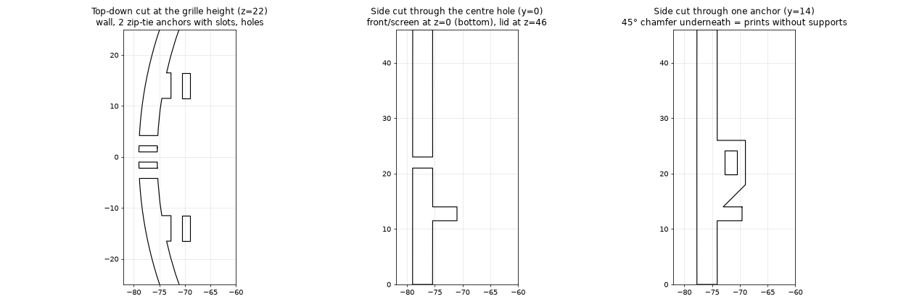

# Hardware: mic port for the enclosure

Jarvis shares the Pi with [Sky Radar](https://github.com/siddhesh1008/sky-radar), which lives in a round
3D-printed enclosure (`sky-radar/hardware`). A USB mic sealed inside that enclosure hears the fan much
better than you: the vents face the ceiling and the pegboard, and the air moving through them is noisy.
Speech arrives muffled, without the high frequencies the wake word needs. In tests, "Hey Jarvis" scored
**0.07** with the mic sealed inside and **0.99** behind this port (Jarvis wakes at 0.5).

`sky-radar-mount-shell-mic.stl` is Sky Radar's front shell with:

- a **grille of 7 × Ø2 mm holes** through the side wall, on the **right when you look at the screen**,
  22 mm behind the front face (just behind the display), away from the fan and the vents;
- two **zip-tie anchors** inside, either side of the grille, with slots for a tie up to 4 mm wide.
  Their undersides are 45° chamfers, so the shell still prints face down without extra supports.

It replaces only the shell. The back lid, screws and assembly are the same as in Sky Radar's
hardware guide, and so are the print settings (PETG, front face down, tree supports from the build plate).



## Fitting the mic

1. Connect the mic to the Pi with a **short, flexible USB extension** (10–20 cm) inside the case,
   so it can reach the grille.
2. Put a thin **foam or felt ring** (about 10 mm across, with a hole in the middle) over the grille on the inside.
3. Hold the mic with its **sound opening on the ring**, then pull a zip tie through both anchors and around the mic.
   The mic should press on the foam, so it hears the room through the holes and not the air inside the case.

## Changing it

The port is added to Sky Radar's exported shell STL by `tools/add_mic_port.py` (trimesh). Change `ANG` (which
side) or `ZC` (depth) and run it again from this folder:

```
pip install trimesh manifold3d shapely numpy
python tools/add_mic_port.py ../../sky-radar/hardware .
```

It is not in Sky Radar's Fusion 360 / STEP files; if the shell is redesigned there, run the script on the new STL.
